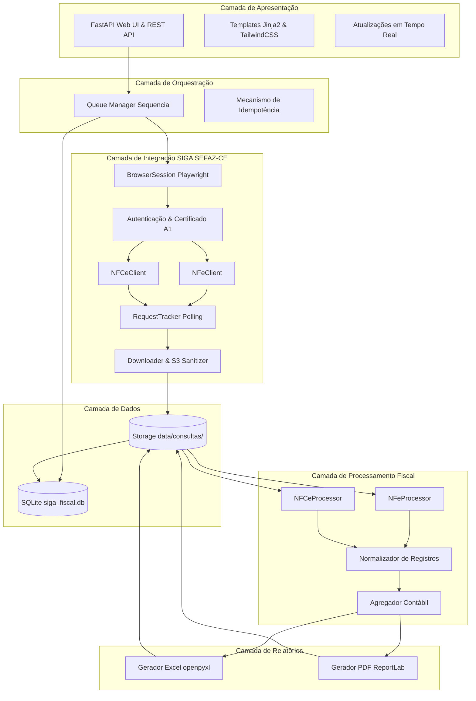

# Arquitetura do Sistema (ARCHITECTURE.md)

Este documento detalha o desenho arquitetural do **SIGA Fiscal**, justificando as decisões técnicas, a separação de responsabilidades e as garantias de segurança e resiliência.

---

## 1. Visão Geral da Arquitetura

O sistema adota uma **Arquitetura em Camadas Desacopladas (Layered Architecture)**, garantindo que o módulo de automação web, os clientes de API, o motor de cálculo e a interface do usuário operem de forma independente.

---

## 2. Detalhamento dos Módulos

### 2.1 `src/web/` (Apresentação e APIs)
- `app.py`: Servidor ASGI baseado em FastAPI. Fornece rotas para visualização do painel em HTML e endpoints REST para consumo assíncrono.
- `templates/`: Templates Jinja2 desacoplados (`dashboard.html`, `empresas.html`, `nova_consulta.html`, `historico.html`, `configuracoes.html`).
- `static/`: Recursos estáticos (estilos e scripts).

### 2.2 `src/orchestrator/` (Orquestração de Lotes)
- Responsável por processar a lista de empresas selecionadas **estritamente em ordem sequencial**.
- **Isolamento de Falha:** Se a Empresa B sofrer uma falha de rede ou certificado inválido, o orquestrador registra o erro no banco e prossegue para a Empresa C sem derrubar o processo.
- **Idempotência:** Antes de emitir novas requisições na SEFAZ, verifica se os arquivos originais válidos já existem em disco.

### 2.3 `src/siga/` (Integração SEFAZ-CE)
- `browser_session.py`: Controla o ciclo de vida do Playwright. Inicia com `headless=False` para viabilizar a caixa nativa de seleção do certificado A1.
- `authentication.py`: Detecta o momento em que o usuário seleciona o certificado e o login é deferido pela SEFAZ.
- `base_client.py`: Abstração base de requisições autenticadas.
- `nfe_client.py`: Chamadas específicas para o endpoint de NF-e (`/documentos-fiscais/nf-e/resumos/eventos/download`).
- `nfce_client.py`: Cliente dedicado à NFC-e, mantido isolado de NF-e para não contaminar a estabilidade do fluxo.
- `request_tracker.py`: Consulta a lista de solicitações (`/solicitacoes?sort=criacao,desc`) e valida por critérios rígidos (CNPJ, período, tipo, operação).
- `downloader.py`: Segue o redirecionamento 302 para a Amazon S3, grava o XLSX em disco e expurga os tokens temporários.

### 2.4 `src/processor/` (Regras de Negócio e Cálculo Fiscal)
- `nfe_processor.py`: Lê planilhas de NF-e e extrai divisões de notas internas, interestaduais e externas.
- `nfce_processor.py`: Lê planilhas de NFC-e conforme layout descoberto.
- `normalizer.py`: Converte diferentes layouts em instâncias de `NormalizedRecord`.
- `aggregator.py`: Aplica a regra fundamental:
  - Faturamento/Movimentação baseia-se **exclusivamente nas notas autorizadas**.
  - Documentos cancelados e denegados são preservados separadamente para auditoria.
  - Subtotais por tipo de documento + total consolidado.

### 2.5 `src/reports/` (Emissão de Relatórios)
- `excel_reporter.py`: Gera pasta de trabalho Excel estilizada com múltiplas abas via `openpyxl`.
- `pdf_reporter.py`: Emite relatório executivo em PDF de alta qualidade com ReportLab.

### 2.6 `src/database/` (Armazenamento de Metadados)
- `connection.py`: Gerenciamento do SQLite em modo WAL e ativação de foreign keys.
- `models.py`: Entidades mapeadas via SQLAlchemy.
- `crud.py`: Operações com validações prévias e sanitização.

### 2.7 `src/utils/` (Utilitários Compartilhados)
- `cnpj_validator.py`: Validação algorítmica de CNPJ e extração do CNPJ Base.
- `sanitizers.py`: Filtro de credenciais e tokens S3.
- `logger.py`: Emissão de logs auditáveis e limpos.
