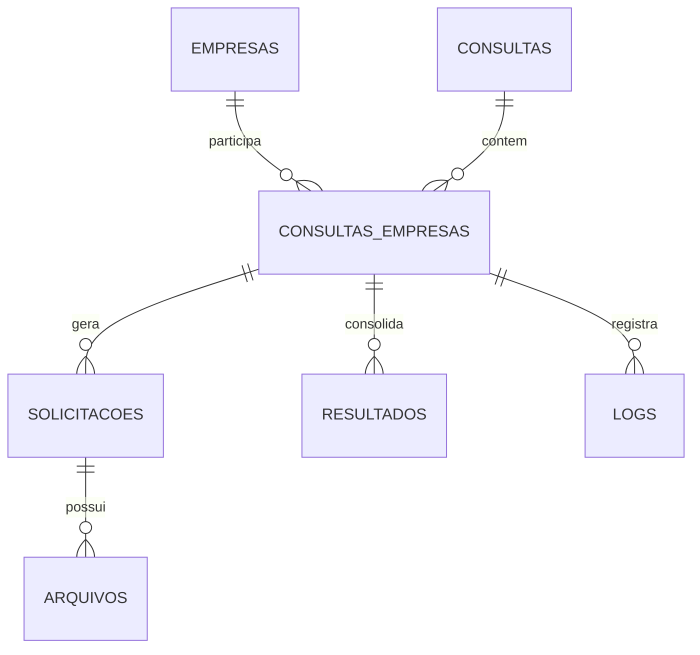

# Dicionário de Dados e Modelo Relacional (DATABASE.md)

O sistema utiliza o banco de dados **SQLite** com **WAL Mode (Write-Ahead Logging)** e verificação estrita de integridade referencial (`PRAGMA foreign_keys = ON`).

O arquivo padrão do banco reside em: `data/db/siga_fiscal.db`.

---

## 1. Esquema Relacional

---

## 2. Tabelas e Dicionário de Campos

### 2.1 Tabela `empresas`
Armazena o cadastro dos contribuintes da SEFAZ-CE.

| Campo | Tipo | Nulo | Descrição |
|---|---|---|---|
| `id` | INTEGER | NÃO | Chave primária autoincrementável |
| `razao_social` | VARCHAR(255) | NÃO | Razão social ou denominação comercial da empresa |
| `cnpj` | VARCHAR(14) | NÃO | CNPJ (14 dígitos sem pontuação). Índice único |
| `cnpj_base` | VARCHAR(8) | NÃO | Primeiros 8 dígitos do CNPJ para agrupamento |
| `cgf` | VARCHAR(20) | SIM | Cadastro Geral da Fazenda do Ceará (Inscrição Estadual) |
| `observacao` | TEXT | SIM | Anotações operacionais ou fiscais |
| `ativa` | BOOLEAN | NÃO | Indicador de empresa habilitada para consultas (Padrão: True) |
| `criado_em` | DATETIME | NÃO | Data/hora de inclusão no banco |
| `atualizado_em`| DATETIME | NÃO | Data/hora da última alteração de dados |

---

### 2.2 Tabela `consultas`
Registra os lotes de consulta disparados pelo usuário.

| Campo | Tipo | Nulo | Descrição |
|---|---|---|---|
| `id` | INTEGER | NÃO | Chave primária autoincrementável |
| `id_lote` | VARCHAR(36) | NÃO | UUID único representativo do lote |
| `data_inicio` | DATE | NÃO | Data inicial do período fiscal consultado |
| `data_fim` | DATE | NÃO | Data final do período fiscal consultado |
| `consultar_nfe` | BOOLEAN | NÃO | Flag indicativa de consulta de NF-e |
| `consultar_nfce` | BOOLEAN | NÃO | Flag indicativa de consulta de NFC-e |
| `consultar_entradas` | BOOLEAN | NÃO | Flag indicativa de consulta de Entradas |
| `consultar_saidas` | BOOLEAN | NÃO | Flag indicativa de consulta de Saídas |
| `status` | VARCHAR(20) | NÃO | Status geral: `PENDENTE`, `EM_ANDAMENTO`, `CONCLUIDO`, `ERRO_PARCIAL`, `ERRO_TOTAL` |
| `total_empresas` | INTEGER | NÃO | Quantidade total de empresas no lote |
| `sucesso_empresas` | INTEGER | NÃO | Quantidade de empresas concluídas com êxito |
| `erro_empresas` | INTEGER | NÃO | Quantidade de empresas que apresentaram erro |
| `criado_em` | DATETIME | NÃO | Data/hora de disparo do lote |
| `finalizado_em` | DATETIME | SIM | Data/hora de término de todas as empresas do lote |

---

### 2.3 Tabela `consultas_empresas`
Associação entre a consulta e cada empresa participante, mantendo o estado de execução individual.

| Campo | Tipo | Nulo | Descrição |
|---|---|---|---|
| `id` | INTEGER | NÃO | Chave primária autoincrementável |
| `consulta_id` | INTEGER | NÃO | FK para `consultas.id` |
| `empresa_id` | INTEGER | NÃO | FK para `empresas.id` |
| `status` | VARCHAR(30) | NÃO | `PENDENTE`, `AGUARDANDO_CERTIFICADO`, `EM_ANDAMENTO`, `CONCLUIDO`, `ERRO` |
| `erro_mensagem` | TEXT | SIM | Detalhe textual do erro, se houver |
| `iniciado_em` | DATETIME | SIM | Momento em que a sessão do navegador foi aberta |
| `finalizado_em`| DATETIME | SIM | Momento em que a sessão do navegador foi encerrada |

---

### 2.4 Tabela `solicitacoes`
Representa cada requisição assíncrona feita aos endpoints de download da SEFAZ-CE.

| Campo | Tipo | Nulo | Descrição |
|---|---|---|---|
| `id` | INTEGER | NÃO | Chave primária autoincrementável |
| `consulta_empresa_id` | INTEGER | SIM | FK para `consultas_empresas.id` |
| `cnpj` | VARCHAR(14) | NÃO | CNPJ do contribuinte |
| `tipo_documento` | VARCHAR(10) | NÃO | `NFE` ou `NFCE` |
| `operacao` | VARCHAR(10) | NÃO | `ENTRADA` ou `SAIDA` |
| `data_inicio` | DATE | NÃO | Início do período da solicitação |
| `data_fim` | DATE | NÃO | Fim do período da solicitação |
| `id_solicitacao_siga` | VARCHAR(100) | SIM | UUID retornado pela SEFAZ |
| `status_siga` | VARCHAR(20) | NÃO | `CRIADA`, `PENDENTE`, `PROCESSANDO`, `CONCLUIDO`, `ERRO`, `EXPIRADO` |
| `criado_em` | DATETIME | NÃO | Data/hora do disparo da solicitação |
| `concluido_em` | DATETIME | SIM | Data/hora da conclusão no SIGA |
| `erro_detalhe` | TEXT | SIM | Mensagem de erro caso o status seja `ERRO` |

---

### 2.5 Tabela `arquivos`
Catálogo de todos os arquivos físicos salvos em disco (planilhas originais e relatórios finais).

| Campo | Tipo | Nulo | Descrição |
|---|---|---|---|
| `id` | INTEGER | NÃO | Chave primária autoincrementável |
| `solicitacao_id` | INTEGER | SIM | FK para `solicitacoes.id` |
| `consulta_empresa_id` | INTEGER | SIM | FK para `consultas_empresas.id` |
| `tipo_arquivo` | VARCHAR(30) | NÃO | `ORIGINAL_XLSX`, `RELATORIO_EXCEL`, `RELATORIO_PDF` |
| `caminho_relativo` | VARCHAR(500) | NÃO | Caminho do arquivo a partir da raiz do projeto |
| `hash_sha256` | VARCHAR(64) | SIM | Checksum SHA-256 para garantia de integridade |
| `tamanho_bytes` | INTEGER | NÃO | Tamanho do arquivo em bytes |
| `criado_em` | DATETIME | NÃO | Data/hora de gravação no storage |

---

### 2.6 Tabela `resultados`
Registros fiscais normalizados extraídos após a leitura das planilhas XLSX.

| Campo | Tipo | Nulo | Descrição |
|---|---|---|---|
| `id` | INTEGER | NÃO | Chave primária autoincrementável |
| `consulta_empresa_id` | INTEGER | NÃO | FK para `consultas_empresas.id` |
| `tipo_documento` | VARCHAR(10) | NÃO | `NFE` ou `NFCE` |
| `operacao` | VARCHAR(10) | NÃO | `ENTRADA` ou `SAIDA` |
| `categoria` | VARCHAR(50) | NÃO | `Interna`, `Interestadual`, `Externa`, etc. |
| `mes` | VARCHAR(20) | NÃO | Mês de competência (ex: `Janeiro`, `2026-01`) |
| `qtd_autorizada` | INTEGER | NÃO | Quantidade de notas fiscais autorizadas |
| `valor_autorizado` | NUMERIC(15,2) | NÃO | Valor monetário das notas autorizadas |
| `qtd_cancelada` | INTEGER | NÃO | Quantidade de notas canceladas (auditoria) |
| `valor_cancelado` | NUMERIC(15,2) | NÃO | Valor monetário das notas canceladas |
| `qtd_denegada` | INTEGER | NÃO | Quantidade de notas denegadas (auditoria) |
| `valor_denegado` | NUMERIC(15,2) | NÃO | Valor monetário das notas denegadas |
| `criado_em` | DATETIME | NÃO | Data/hora de processamento |

---

### 2.7 Tabela `logs`
Logs operacionais estruturados e higienizados.

| Campo | Tipo | Nulo | Descrição |
|---|---|---|---|
| `id` | INTEGER | NÃO | Chave primária autoincrementável |
| `consulta_empresa_id` | INTEGER | SIM | FK opcional para rastreamento contextual |
| `nivel` | VARCHAR(10) | NÃO | `INFO`, `WARN`, `ERROR` |
| `mensagem` | TEXT | NÃO | Conteúdo textual previamente sanitizado |
| `timestamp` | DATETIME | NÃO | Data/hora do evento |
